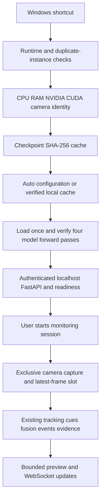

# Adaptive Runtime — thiết kế triển khai

Auto là lớp cấu hình quanh `LiveValidationOrchestrator`, `Stage2Pipeline`, `ModelRegistry`, các `VideoSource` và dashboard hiện có. Không thêm loại hành vi hay thay đổi checkpoint, nhãn lớp, confidence gates, fusion, debounce, cooldown hoặc thẩm quyền Confirm/Dismiss của giám thị.

`src/orchestration/adaptive_runtime.py` thu thập OS/architecture, Python/package versions, CPU threads/RAM, NVIDIA driver/VRAM/compute capability và thực thi kernel CUDA thật. Backend hỗ trợ hiện tại là PyTorch CUDA và CPU. Không giả định DirectML, Intel/AMD GPU hoặc TensorRT đã hoạt động.

Camera được định danh bằng DirectShow moniker khi có FFmpeg, PnP khi một thiết bị không gây nhập nhằng. Danh sách advertised formats khác với kiểm chứng vật lý: mỗi candidate phải mở, lấy frame, xác nhận FOURCC/resolution và đo tốc độ. Trên máy đủ RAM/GPU, ưu tiên chế độ MJPEG 4K30 được quảng bá và đo đạt cadence an toàn. Không chọn theo chuỗi tên RTX. Các probe giải phóng handle trước khi runtime giữ camera theo phiên.

`WebcamSource` bổ sung các tùy chọn opt-in `fourcc` và `async_capture`. Cách gọi cũ, video file, RTSP và multi-camera workers vẫn dùng interface cũ. Capture background giữ một frame mới nhất; consumer bỏ frame cũ có đếm riêng, giữ nguyên timestamp/frame index gốc. Không tạo quan sát giả để bù frame. Khi mất camera, ngừng phiên xử lý thay vì tự chuyển thiết bị.

Capture resolution, AI input, AI cadence và preview độc lập. Detector chọn 960 khi CUDA khả dụng, VRAM ≥ 8192 MiB và RAM khả dụng ≥ 4096 MiB; CPU hoặc máy không đủ bộ nhớ giữ 640, bao gồm cấu hình ASUS 4 GiB tham chiếu. Macro giữ 768, posture/headpose 224. Bản gốc 4K đi vào pipeline/evidence; preview giảm về tối đa 1280 pixel và bbox xuất ra được scale tương ứng. Bằng chứng không bị resize theo preview. GPU forward kiểm tra backend thực thi của Ultralytics, không kiểm tra nhầm checkpoint object còn nằm trên CPU. Sau khi Ultralytics khởi tạo, TF32 được tắt để giữ tính nhất quán FP32; không sửa score để che sai khác.

Lần đầu, cadence lấy từ thời gian forward có CUDA synchronize, camera FPS và ngân sách bộ nhớ; queue hiện có vẫn bounded. Trong phiên chỉ cập nhật số đo và lưu đề xuất. Lần mở tiếp theo dùng throughput toàn pipeline, latency p95, queue depth và memory pressure đã quan sát để chọn nhịp an toàn ở ranh giới startup. Không đổi model/threshold hoặc cadence liên tục giữa một cửa sổ sự kiện.

`.runtime/auto-settings.json` lưu camera/mode/cadence cùng fingerprint OS, Python/package versions, driver/GPU, RAM tổng, camera và các file cấu hình/runtime quan trọng. Không đưa biến động RAM trống tức thời vào fingerprint để tránh probe mỗi lần. Checkpoint cache đối chiếu size/mtime/ctime với hash chuẩn; nội dung thay đổi được hash lại. Đây là kiểm tra integrity cục bộ, không phải chống một tài khoản Windows cố ý sửa metadata/cache.

Windows mutex bảo vệ startup; file lock ngăn runtime trùng lặp. `/health` vẫn giữ tương thích; `/ready` chỉ trả thành công sau forward của bốn model và chứa instance nonce/PID để launcher kiểm tra. Thông tin riêng và video vẫn yêu cầu authentication. Stop xác minh process ownership, dùng stop signal, đóng nguồn/evidence/session/server theo lifecycle hiện có; timeout được báo thật và không cưỡng bức kill process lạ.

RTSP tùy chọn dùng reference DPAPI theo CurrentUser. RTSP/video vẫn có provenance riêng, không được gắn thành webcam thật. ASUS YAML và launcher tham chiếu giữ nguyên. Kết quả thực nghiệm và giới hạn: [final-academic-validation.md](final-academic-validation.md).
